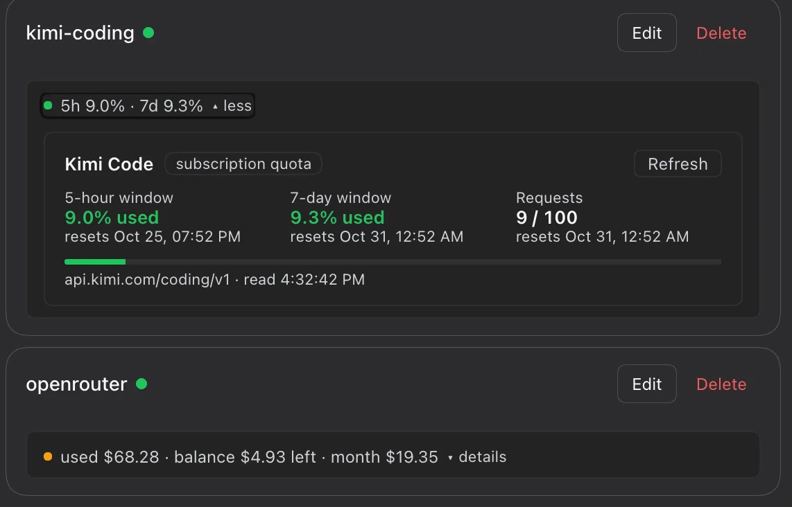

# dsh-plugin-provider-usage

Provider balances and subscription quota inside DeepSeek Harness.
OpenRouter, Kimi Code, DeepSeek, GLM Coding Plan, MiniMax Coding Plan, and
NewAPI are supported in one package.

## Install

### Desktop app

Open **Settings → Plugins → Add plugin → Install a third-party plugin**.
Enter `dsh-plugin-provider-usage`, install it, and enable it.

### Web or CLI

```sh
dsh plugin --profile web add dsh-plugin-provider-usage@latest
```

Replace `web` with your profile name when needed. Restart the Host and
refresh the page after installation.

> Registry installation requires the package to be published on npm. To try
> the source checkout before publication, use the development command below.

Read the [complete installation, configuration, and security guide](packages/usage/README.md).

## Preview

Usage appears inside configured provider cards. A composer chip follows the
active provider.



| OpenRouter chip | Kimi Code chip |
|---|---|
|  |  |

## Packages

| Directory | npm package | Purpose |
|---|---|---|
| [`packages/usage`](packages/usage) | `dsh-plugin-provider-usage` | Provider-card usage, active-provider composer chips, and `/usage-*` commands |

## Repository layout

- `packages/usage/src/index.host.js` is the Host entry.
- `packages/usage/src/providers/` contains one isolated module per provider.
- `packages/usage/src/client.js` is the self-contained Web client.
- `packages/usage/cordis.patch.yml` declares the plugin row and defaults.
- Packages ship directly from `src/`. No build or copy step is required.

## Development

```sh
git clone https://github.com/anvilsong/dsh-plugin-provider-usage.git
cd dsh-plugin-provider-usage

node --check packages/usage/src/index.host.js
node --check packages/usage/src/client.js

# Link this checkout into a development profile:
dsh plugin --profile web add "$PWD/packages/usage"
```

Replace `web` with another development profile when needed. Use the Desktop
app's **Settings → Plugins** page for normal Desktop installations.

Reload the page after a client-only change. Restart the Host after a Host or
composition change.

## License

The usage package is [MIT licensed](packages/usage/LICENSE).
